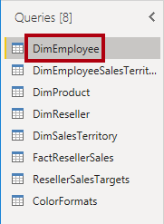
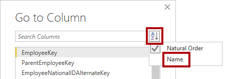
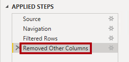
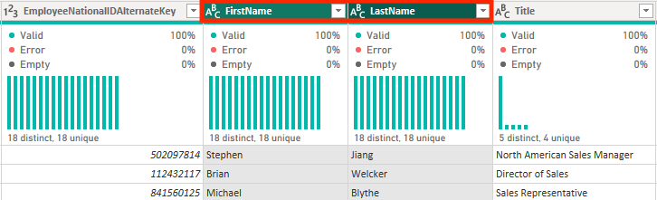
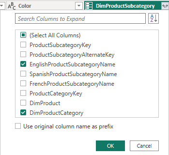

# Certificación PL-300: Power BI Data Analyst
## Práctica 02: Limpieza, Transformación y Carga de Datos en Power BI

### Descripción del Escenario
En esta sesión práctica aplicarás técnicas de depuración, filtrado y transformación en Power Query con el fin de estructurar el modelo analítico. Finalmente, se consolidarán las consultas para transferirlas como tablas hacia el modelo semántico de Power BI.

**Objetivos clave:**
- Implementar transformaciones de datos estructurados y desnormalización de tablas.
- Integrar y cargar consultas depuradas en el modelo semántico.
- **Duración estimada:** 45 minutos.

---

## 1. Puesta en Marcha y Descarga de Recursos

1. Abre el navegador y descarga el paquete con los materiales desde el repositorio oficial:
   > `https://github.com/MicrosoftLearning/PL-300-Microsoft-Power-BI-Data-Analyst/raw/Main/Allfiles/Labs/02-transform-data-power-bi/02-transform-data.zip`
2. Descomprime el contenido dentro del directorio de trabajo: `C:\Users\Student\Downloads\02-transform-data`.
3. Inicia el archivo de proyecto base **02-Starter-Sales Analysis.pbix**.

> **Nota:** Si aparece una ventana solicitando inicio de sesión, pulsa **Cancel**. Cierra avisos secundarios y, si el sistema solicita aplicar cambios pendientes, selecciona **Apply Later**.

<br>

---

## 2. Configuración de la Consulta «Salesperson»

Procederemos a depurar los datos de los empleados comerciales mediante el Editor de Power Query.

> **Importante:** Respeta minuciosamente la ortografía de las columnas y tablas indicadas para garantizar la compatibilidad de las operaciones posteriores.

1. Desde la pestaña **Home**, dentro de la agrupación **Queries**, haz clic sobre **Transform Data** para iniciar el entorno de Power Query.


<br>

2. En el panel izquierdo de **Queries**, marca la consulta denominada **DimEmployee**.



<br>

> *Aviso:* Si salta una advertencia sobre el tipo de conexión, haz clic en **Edit Credentials**, selecciona las credenciales actuales y pulsa **OK** habilitando la conexión sin cifrar.

3. En el panel derecho de **Query Settings**, ubica la caja **Name** y sustituye el valor por **Salesperson**, confirmando con **Enter**. Comprueba que el cambio se refleje en el listado de consultas.


<br>

4. Para localizar un campo con rapidez, dirígete a la pestaña **Home**, pulsa en el selector de **Choose Columns** y escoge **Go to Column**.


<br>

5. En la ventana emergente, ordena los campos alfabéticamente pulsando el botón **AZ** y selecciona la columna **Name**.



<br>

6. Encuentra la columna **SalesPersonFlag**, despliega su filtro y deja marcado únicamente el valor **TRUE** para conservar sólo a los comerciales en plantilla.


<br>


<br>

7. Comprueba en el panel lateral que la acción ha quedado registrada dentro de **Applied Steps** bajo el nombre **Filtered Rows**.


<br>

8. Para limpiar campos innecesarios, en la cinta **Home** haz clic sobre el icono **Choose Columns**.
9. Desmarca la casilla general **(Select All Columns)** para limpiar la selección.
10. Activa únicamente las siguientes seis columnas:
    - `EmployeeKey`
    - `EmployeeNationalIDAlternateKey`
    - `FirstName`
    - `LastName`
    - `Title`
    - `EmailAddress`


<br>

11. Verifica que se ha añadido el paso correspondiente de eliminación de columnas en el historial de transformaciones.



<br>


<br>

12. Para unificar nombre y apellidos en una única columna, selecciona primero el encabezado **FirstName** y, manteniendo presionada la tecla **Ctrl**, haz clic sobre **LastName**.



<br>

13. Haz clic derecho sobre cualquiera de las dos cabeceras seleccionadas y elige la opción **Merge Columns**.
14. En el diálogo de combinación, define el delimitador **Separator** como **Space**.


<br>

15. En el campo **New Column Name**, escribe **Salesperson** como nombre resultante.
16. Renombra la columna **EmployeeNationalIDAlternateKey** haciendo doble clic sobre su título y cambiándolo a **EmployeeID**.
17. Cambia el nombre de la columna **EmailAddress** por **UPN** (*User Principal Name*).

> **Validación:** En la barra inferior del editor, constata que la consulta presenta **5 columnas y 18 filas**.


<br>

---

## 3. Configuración de la Consulta «SalespersonRegion»

1. En la lista de consultas, selecciona **DimEmployeeSalesTerritory**.
2. En las propiedades de la consulta a la derecha, renómbrala como **SalespersonRegion**.
3. Selecciona la columna **DimEmployee** y, manteniendo pulsada la tecla **Ctrl**, marca también **DimSalesTerritory**.
4. Haz clic derecho sobre cualquiera de ellas y pulsa **Remove Columns**.

> **Validación:** Comprueba en la barra de estado que la consulta se compone de **2 columnas y 39 filas**.


<br>

---

## 4. Configuración de la Consulta «Product»

1. Elige la consulta **DimProduct** y cámbiale el nombre a **Product**.
2. Ubica la columna **FinishedGoodsFlag** y fíltrala para conservar únicamente los registros con valor **TRUE**.


<br>

3. Elimina todas las columnas del conjunto excepto las siguientes:
   - `ProductKey`
   - `EnglishProductName`
   - `StandardCost`
   - `Color`
   - `DimProductSubcategory`


<br>

4. La columna **DimProductSubcategory** contiene referencias vinculadas a otra entidad. Haz clic en el icono de expansión situado en la parte derecha de su cabecera.


<br>

5. Desmarca la casilla **Select All Columns**.
6. Selecciona únicamente **EnglishProductSubcategoryName** y **DimProductCategory**, y asegúrate de **desmarcar** la opción *Use Original Column Name as Prefix*.



<br>

7. Revisa que se han incorporado las columnas y que la original ha quedado sustituida.


<br>

8. Ahora expande la nueva columna **DimProductCategory** incorporando únicamente el campo **EnglishProductCategoryName**.


<br>

9. Renombra las siguientes cuatro columnas para homologar el formato:
   - `EnglishProductName` $\rightarrow$ **Product**
   - `StandardCost` $\rightarrow$ **Standard Cost** *(con espacio intermedio)*
   - `EnglishProductSubcategoryName` $\rightarrow$ **Subcategory**
   - `EnglishProductCategoryName` $\rightarrow$ **Category**

> **Validación:** Verifica en la esquina inferior izquierda que la consulta contenga **6 columnas y 397 filas**.


<br>

---

## 5. Configuración de la Consulta «Reseller»

1. Selecciona **DimReseller** y cámbiale el nombre por **Reseller**.
2. Conserva únicamente estas cuatro columnas, eliminando las restantes:
   - `ResellerKey`
   - `BusinessType`
   - `ResellerName`
   - `DimGeography`


<br>

3. Expande el objeto **DimGeography** para extraer exclusivamente:
   - `City`
   - `StateProvinceName`
   - `EnglishCountryRegionName`


<br>

4. Despliega los valores de la columna **BusinessType** y comprueba la inconsistencia de nombres: existen entradas con **Warehouse** y otras con **Ware House**.
5. Haz clic con el botón derecho en el encabezado de **BusinessType** y pulsa **Replace Values**.
6. En la ventana emergente, sustituye el texto:
   - **Value to Find:** `Ware House`
   - **Replace With:** `Warehouse`


<br>


<br>


<br>

7. Renombra los siguientes campos:
   - `BusinessType` $\rightarrow$ **Business Type**
   - `ResellerName` $\rightarrow$ **Reseller**
   - `StateProvinceName` $\rightarrow$ **State-Province**
   - `EnglishCountryRegionName` $\rightarrow$ **Country-Region**

> **Validación:** Asegúrate de que la consulta muestre **6 columnas y 701 filas**.


<br>

---

## 6. Configuración de la Consulta «Region»

1. Selecciona la consulta **DimSalesTerritory** y nómbrala **Region**.
2. Aplica un filtro sobre **SalesTerritoryAlternateKey** para descartar el valor numérico **0** *(esto retirará una fila del conjunto)*.


<br>

3. Elimina todas las columnas exceptuando:
   - `SalesTerritoryKey`
   - `SalesTerritoryRegion`
   - `SalesTerritoryCountry`
   - `SalesTerritoryGroup`
4. Renombra los atributos eliminando el prefijo:
   - `SalesTerritoryRegion` $\rightarrow$ **Region**
   - `SalesTerritoryCountry` $\rightarrow$ **Country**
   - `SalesTerritoryGroup` $\rightarrow$ **Group**

> **Validación:** Revisa que la consulta cuente con **4 columnas y 10 filas**.


<br>

---

## 7. Configuración de la Consulta «Sales»

1. Localiza la consulta **FactResellerSales** y renómbrala como **Sales**.
2. Retira todas las columnas dejando únicamente:
   - `SalesOrderNumber`
   - `OrderDate`
   - `ProductKey`
   - `ResellerKey`
   - `EmployeeKey`
   - `SalesTerritoryKey`
   - `OrderQuantity`
   - `UnitPrice`
   - `TotalProductCost`
   - `SalesAmount`
   - `DimProduct`


<br>

3. Expande la columna relacionada **DimProduct** marcando exclusivamente el campo **StandardCost**.
4. Para solventar los costes nulos, dirígete a la pestaña **Add Column** y pulsa **Custom Column**.


<br>

5. Asigna el nombre **Cost** a la nueva columna.
6. En la caja de fórmula introduce la siguiente expresión lógica de cálculo condicional:
   
```powerquery
   if [TotalProductCost] = null then [OrderQuantity] * [StandardCost] else [TotalProductCost]
